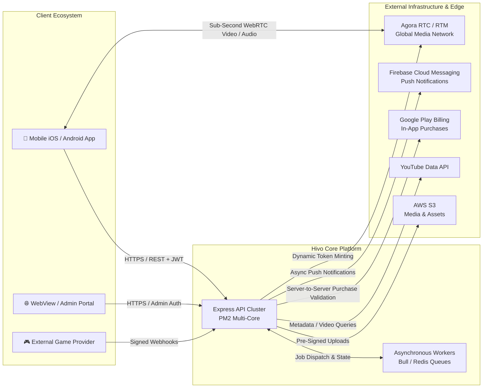
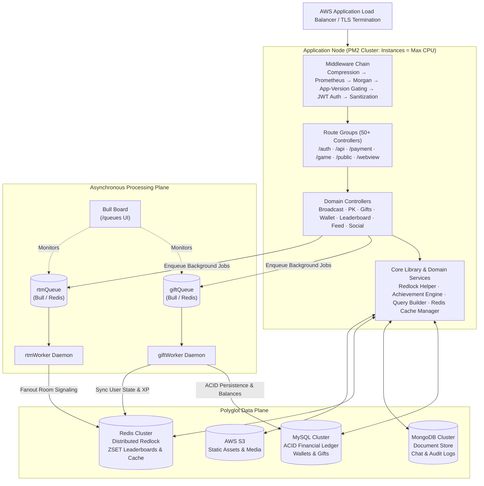
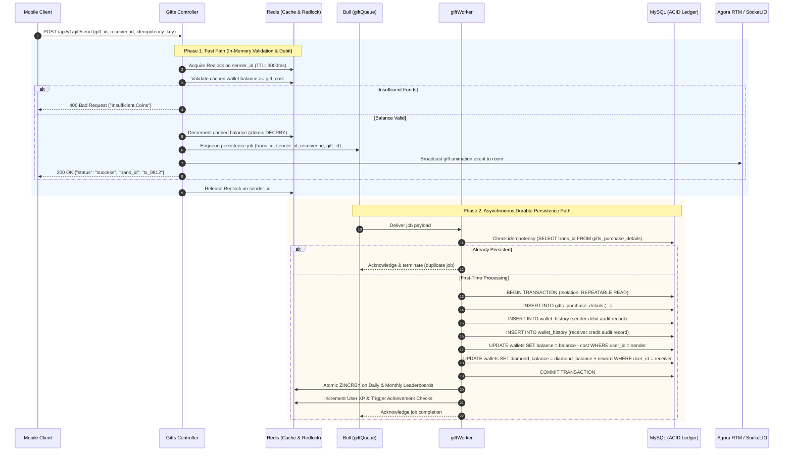
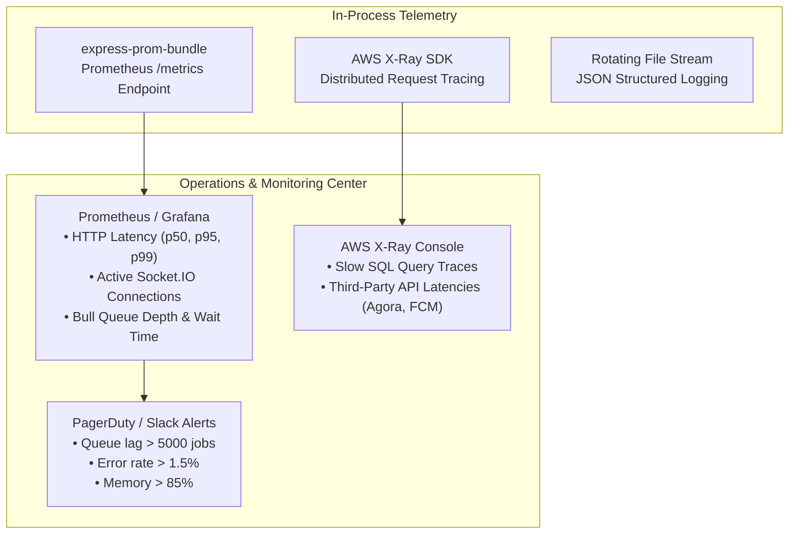

# 🎥 Real-Time Live Streaming & Social Commerce Platform

<div align="center">

### End-to-End Engineering Case Study: High-Throughput Live Video, Real-Time Fanout, and Financial-Grade Virtual Economy

[](https://nodejs.org/)
[](https://www.mysql.com/)
[](https://www.mongodb.com/)
[](https://redis.io/)
[](https://optimalbits.github.io/bull/)
[](https://aws.amazon.com/)
[](https://www.agora.io/)
[](https://socket.io/)
[](https://prometheus.io/)

</div>

> [!NOTE]
> **Confidentiality & Engineering Portfolio Notice**  
> This repository is a technical case study detailing the architectural design, engineering trade-offs, and production operations of a commercial live-streaming platform. Proprietary source code, production credentials, internal IP addresses, secret keys, and confidential business logic are strictly omitted in compliance with non-disclosure obligations. All architectural diagrams and system workflows represent sanitized, production-verified designs.

---

## 📑 Table of Contents

1. [Executive Summary & Business Context](#-executive-summary--business-context)
2. [Engineering Ownership & My Role](#-engineering-ownership--my-role)
3. [System Context & External Integrations](#-system-context--external-integrations)
4. [Platform Capability Map](#-platform-capability-map)
5. [System Architecture & Logical Design](#-system-architecture--logical-design)
   - [Modular Monolith & Layered Plane Separation](#1-modular-monolith--layered-plane-separation)
   - [Real-Time Fanout & Presence Architecture](#2-real-time-fanout--presence-architecture)
6. [Deep-Dive Engineering Challenges & Solutions](#-deep-dive-engineering-challenges--solutions)
   - [Challenge 1: High-Concurrency Virtual Gifting & Financial Ledger](#challenge-1-high-concurrency-virtual-gifting--financial-ledger)
   - [Challenge 2: Sub-Second Interactive Video Transport & Signaling](#challenge-2-sub-second-interactive-video-transport--signaling)
   - [Challenge 3: High-Velocity Leaderboards & Hot-Key Caching](#challenge-3-high-velocity-leaderboards--hot-key-caching)
   - [Challenge 4: Asynchronous Resilience & Data Reconciliation](#challenge-4-asynchronous-resilience--data-reconciliation)
   - [Challenge 5: Zero-Downtime Multi-Core Deployment on AWS](#challenge-5-zero-downtime-multi-core-deployment-on-aws)
7. [The Virtual Gifting Pipeline (Sequence Deep-Dive)](#-the-virtual-gifting-pipeline-sequence-deep-dive)
8. [Technology Stack & Decision Matrix](#-technology-stack--decision-matrix)
9. [Observability & Production Operations](#-observability--production-operations)
10. [Measurable Scale, Performance & Business Impact](#-measurable-scale-performance--business-impact)
11. [Engineering Trade-Offs & Lessons Learned](#-engineering-trade-offs--lessons-learned)
12. [Future Architectural Roadmap](#-future-architectural-roadmap)
13. [Author & Technical Leadership](#-author--technical-leadership)

---

## 🧭 Executive Summary & Business Context

Interactive live streaming sits at the intersection of ultra-low latency media transport and high-velocity financial transactions. Creators broadcast live video feeds to tens of thousands of concurrent viewers who interact through real-time chat, streamer-vs-streamer (PK) battles, and **virtual gifts purchased with real fiat currency**.

Operating this platform presents four conflicting engineering requirements:
1. **Strict Latency Budget (< 1000 ms):** Video streams, chat comments, and gift visual triggers must arrive synchronously. A gift animation arriving 2 seconds after the viewer clicked "Send" destroys the interactive illusion.
2. **Zero-Tolerance Financial Consistency:** Virtual currency balances and transactions represent real revenue. Double-spending, balance discrepancies, or dropped purchases represent legal compliance failures and direct financial loss.
3. **Severe Traffic Spikiness:** A popular creator initiating an unscheduled broadcast causes viewer concurrency and inbound request volume to spike by up to $50\times$ within 90 seconds.
4. **Operational Resilience:** An unexpected backend failure during a top creator's live broadcast disrupts thousands of paying viewers, creating immediate reputational and revenue damage.

### High-Level System Profile

| Dimension | Production Metric / Characteristic |
|---|---|
| **Domain** | Interactive Live Video · Social Commerce · Virtual Gifting Economy |
| **Architectural Style** | Modular Monolith + Asynchronous Workers + Polyglot Persistence |
| **API Surface** | 50+ Controllers across 5 Route Groups (`/auth`, `/api`, `/payment`, `/game`, `/public`, `/webview`) |
| **Real-Time Transport** | Agora RTC / RTM, Socket.IO, Redis Pub/Sub |
| **Persistence Tier** | MySQL (ACID Ledger), MongoDB (Unstructured Logs), Redis (Cache & Redlock) |
| **Cloud Infrastructure** | AWS (EC2, S3, SQS, CodeDeploy, X-Ray), Firebase Cloud Messaging |
| **Commercial Scale** | **$20M+ cumulative revenue** processed across platforms, **100,000+ Monthly Active Users (MAU)** |

---

## 👤 Engineering Ownership & My Role

As the Principal / Lead Backend Architect, I had end-to-end technical ownership for the backend system architecture, transactional integrity, and production cloud operations:

- **Distributed Architecture & Boundary Design:** Architected the modular monolith service boundaries, asynchronous queue pipelines, and multi-tier polyglot persistence schema.
- **Financial Transaction Engine:** Designed and implemented the atomic virtual gifting pipeline, wallet ledger, distributed locking mechanisms, and idempotent payout systems.
- **Real-Time Integration & Signaling:** Integrated Agora RTC/RTM for WebRTC-class video ingest and distribution, orchestrated Socket.IO room fanout, and configured Redis Pub/Sub message buses.
- **Reliability & Data Reconciliation:** Engineered automated background reconciliation daemons to identify and resolve edge-case state drift between in-memory caches and the relational ledger.
- **AWS Infrastructure & Zero-Downtime Deployment:** Structured the multi-core PM2 cluster orchestration, automated AWS CodeDeploy blue/green deployment hooks, and configured AWS X-Ray tracing.

---

## 🌐 System Context & External Integrations

The platform acts as the central coordinator between client mobile devices, low-latency media transport providers, payment processors, and notification systems:



---

## 🗺️ Platform Capability Map

The application logic is organized into six cohesive domain capabilities:

```
+---------------------------------------------------------------------------------------------------------+
|                                         PLATFORM CAPABILITY MAP                                         |
+------------------------------------+------------------------------------+-------------------------------+
| 🎬 LIVE STREAMING & BROADCAST      | ⚔️ PK BATTLES & COMPETITIONS       | 💎 VIRTUAL ECONOMY & WALLET   |
| • Public, private, & VIP rooms     | • Streamer vs Streamer matching    | • Virtual gifts & animations  |
| • Host broadcast lifecycle mgmt    | • Real-time dual scoring engine    | • Lucky gifts (RTP reserve)   |
| • Participant roles & moderation   | • Micro-second score aggregation   | • Backpack inventory & store  |
| • Dynamic Agora RTC token issuance | • Dynamic battle leaderboards      | • Double-entry wallet ledger  |
| • Home explore & recommendation    | • Penalty & victory countdowns     | • Google Play IAP validation  |
+------------------------------------+------------------------------------+-------------------------------+
| 👥 SOCIAL & RELATIONSHIPS          | 🏆 GAMIFICATION & ENGAGEMENT       | 🛠️ PLATFORM & FOUNDATION      |
| • Mutual follower & friend graph   | • Daily, monthly, lifetime boards  | • Multi-tier JWT token gating |
| • Real-time direct & room chat     | • User experience & tier levels    | • App version gating & config |
| • Couples (CP) relationship spaces | • VIP / SVIP subscriber badges     | • Dynamic image compression   |
| • Push notification pipelines      | • Achievement & quest engine       | • Distributed logging & audit |
| • User reporting & help center     | • Daily check-in streak rewards    | • Active cache synchronization|
+------------------------------------+------------------------------------+-------------------------------+
```

---

## 🏛️ System Architecture & Logical Design

### 1. Modular Monolith & Layered Plane Separation

The platform utilizes a **Modular Monolith architecture with Asynchronous Workers**. This design delivers the operational simplicity and shared-memory efficiencies of a single deployable unit while cleanly isolating the synchronous HTTP request path from heavy background jobs:



### 2. Real-Time Fanout & Presence Architecture

Handling interactive room interactions requires separating video delivery from state fanout:
- **Video / Audio Ingest & SFU Distribution:** Delegated entirely to Agora's global edge network via WebRTC. The backend mints dynamic, cryptographically signed channel keys, keeping media transport off the application servers.
- **In-Room Chat, Reactions & Signaling:** Orchestrated via Socket.IO backed by Redis Pub/Sub adapters. Each room corresponds to an isolated pub/sub channel.
- **Presence Tracking:** Monitored using Redis in-memory sets with periodic heartbeat expiries, avoiding relational database lookups for user join/leave events.

---

## 🔬 Deep-Dive Engineering Challenges & Solutions

### Challenge 1: High-Concurrency Virtual Gifting & Financial Ledger

#### Problem & Context
During peak live events or PK battles, hundreds of viewers send virtual gifts to a creator within seconds. Each gift transaction represents real currency:
- The sender’s wallet must be debited.
- The creator's balance must be credited.
- Room-wide visual animations must be triggered immediately.
- A double-spend or dropped record is a financial reconciliation incident.

#### Constraints
- Direct relational database transactions (`BEGIN...COMMIT`) with row-level locks on sender and receiver wallet records cannot handle thousands of concurrent requests without thread pool exhaustion and lock timeouts.
- In-memory-only updates risk balance loss if a node crashes before persisting to disk.

#### Engineering Approach: Two-Phase Gifting Pipeline
We engineered a decoupled, two-phase execution pipeline combining **in-memory distributed locking** with **asynchronous durable persistence**:

```
+--------------------------------------------------------------------------------------------------+
|                              TWO-PHASE VIRTUAL GIFTING PIPELINE                                  |
|                                                                                                  |
|   1. FAST PATH (Synchronous HTTP: ~25ms)                                                         |
|   Client Request ──> Redlock (Sender ID) ──> Redis Balance Check ──> Redis Debit ──> Ack to User  |
|                                                                    │                             |
|                                                                    ▼                             |
|                                                         Enqueue Persistence Job                  |
|                                                                    │                             |
|   2. DURABLE PATH (Asynchronous Worker: Bull Queue)                ▼                             |
|   Worker ──> Idempotency Check (Trans ID) ──> MySQL REPEATABLE READ Transaction ──> Commit / Log |
|                                                • INSERT gift_purchase_details                    |
|                                                • INSERT wallet_history (audit)                   |
|                                                • UPDATE balances (atomic inc)                    |
+--------------------------------------------------------------------------------------------------+
```

1. **Fast-Path Verification:** The API acquires a distributed lock (`Redlock`) on the sender's user ID in Redis. It verifies and decrements the user's cached wallet balance in memory, generates a unique `send_gift_trans_id`, and immediately pushes an asynchronous job to the Bull `giftQueue`.
2. **Immediate Signaling:** The fast path triggers the room-wide Agora RTM animation signal, returning `200 OK` to the sender in under 30 ms.
3. **Durable Persistence (Worker Plane):** The decoupled `giftWorker` picks up the job, validates the transaction ID against an idempotency table, opens a MySQL transaction (`REPEATABLE READ`), writes double-entry ledger records (`wallet_history`), and updates database balances using atomic increments (`UPDATE wallets SET balance = balance - X WHERE balance >= X`).
4. **Outcome:** Absorbed massive gifting spikes during live battles without database lock contention, maintaining zero financial discrepancies across millions of transactions.

---

### Challenge 2: Sub-Second Interactive Video Transport & Signaling

#### Problem & Context
Early live streaming architectures relied on HLS/RTMP protocols, which introduce $3$ to $8$ seconds of latency. In interactive live entertainment, high latency makes creator-viewer conversation impossible and breaks the psychology of live tipping.

#### Engineering Approach & Trade-Offs
- **Decision:** Rather than engineering an in-house Selective Forwarding Unit (SFU) cluster—which requires substantial maintenance across global edge locations—we adopted **Agora WebRTC infrastructure for media transport**.
- **Edge Token Minting:** The Node.js API acts as an authoritative gatekeeper, generating short-lived, role-based RTC tokens (`agora-access-token`) containing room permissions (broadcaster vs. audience).
- **Dual-Channel Separation:** High-bandwidth media streams travel directly between clients and Agora edge nodes, while transactional and business logic passes through the Node.js API.
- **Outcome:** Reduced end-to-end video latency to **$< 800\text{ ms}$ globally**, allowing instant real-time responses between creators and audiences.

---

### Challenge 3: High-Velocity Leaderboards & Hot-Key Caching

#### Problem & Context
The platform features Daily, Monthly, Lifetime, and PK Battle leaderboards displaying top gift contributors and streamers. Querying `SUM(gift_value)` from relational tables for thousands of concurrent users brings relational databases to an immediate halt.

#### Engineering Approach: Redis Sorted Sets (ZSET)
- **Data Structure:** Implemented leaderboards using Redis Sorted Sets (`ZSET`). Scores are updated in real time via atomic `ZINCRBY` operations as gifts are processed.
- **Pagination via `ZREVRANGE`:** Retrieving the top 100 rankers runs in $O(\log(N) + M)$ time complexity, executing in $< 2\text{ ms}$.
- **Write-Behind Synchronization:** Background workers periodically snapshot Redis rankings into MySQL archival tables for historical reporting, completely shielding the relational database from leaderboard read traffic.

---

### Challenge 4: Asynchronous Resilience & Data Reconciliation

#### Problem & Context
In any distributed architecture separating in-memory caches (Redis) from persistent storage (MySQL), unexpected worker crashes, network partitions, or unhandled exceptions can cause state drift between cached balances and the relational source of truth.

#### Engineering Approach: Production Reconciliation Tooling
Rather than assuming distributed transactions never fail, we engineered automated background reconciliation daemons (`scripts/` suite):

```
+-------------------------------------------------------------------------------------------------+
|                                 DATA RECONCILIATION SUITE                                       |
|                                                                                                 |
|   [ walletMissmatchCheck.js ]  ─── Compares Redis cached balances against SQL ledger sum        |
|   [ walletSyncFromCache.js ]   ─── Resolves in-flight discrepancies with atomic balance locks   |
|   [ leaderboardSync.js ]       ─── Rebuilds corrupted ZSET rankings from verified SQL audit logs|
|   [ contributorListSync.js ]   ─── Recalculates top gift contributors post-network partitions   |
+-------------------------------------------------------------------------------------------------+
```

- **Safety Invariant:** MySQL is the permanent source of truth; Redis is an expendable accelerator.
- **Scheduled Audit Sweeps:** Nightly reconciliation jobs audit total issued coins against consumed gifts and system balances, alerting engineering immediately to any mathematical anomalies.

---

### Challenge 5: Zero-Downtime Multi-Core Deployment on AWS

#### Problem & Context
Because live video streams run continuously around the clock across global time zones, there is no acceptable "maintenance window." Restarting the Node.js API server dropped active WebSocket connections, disrupting thousands of live broadcasts.

#### Engineering Approach: PM2 Clustering + AWS CodeDeploy
1. **Multi-Core Exploitation:** Configured PM2 cluster mode (`instances: 'max'`, `exec_mode: 'cluster'`) utilizing Node.js's cluster module to bind an instance to every available CPU core behind a shared IPC port.
2. **Graceful Reloads:** Deployments utilize `pm2 reload ecosystem.config.js`, which restarts worker processes sequentially:
   - Worker $N$ stops accepting new connections, drains existing HTTP requests within a 5-second grace period, and terminates.
   - Worker $N+1$ boots and handles incoming traffic before the previous worker stops.
3. **AWS CodeDeploy Lifecycle:** Automated lifecycle scripts (`appspec.yml`) manage package installation, environment variable decryption, asset compilation, and rolling reloads without taking the load balancer target group offline.

---

## 💸 The Virtual Gifting Pipeline (Sequence Deep-Dive)

This sequence diagram illustrates the complete execution path of a high-value virtual gift transaction:



---

## 🛠️ Technology Stack & Decision Matrix

| Architectural Layer | Production Technology | Evaluated Alternative | Architectural Rationale & Trade-Offs |
|---|---|---|---|
| **API Runtime** | **Node.js (v18/v20) + Express** | Go (Gin) / Java (Spring) | Rapid feature velocity for 50+ domain controllers; non-blocking asynchronous event loop ideal for high-I/O signaling and third-party orchestration. |
| **Media Transport** | **Agora RTC / RTM SDK** | Self-hosted WebRTC / Janus SFU | Offloads petabytes of global video bandwidth and multi-region SFU edge operations; allows engineering focus on proprietary monetization and engagement logic. |
| **Relational Ledger** | **MySQL (InnoDB / Pool Booster)** | PostgreSQL | Proven ACID reliability for financial transactions; `mysql-pool-booster` delivers connection reuse under high worker thread concurrency. |
| **Document Storage** | **MongoDB (Mongoose)** | Cassandra / DynamoDB | Schema flexibility for unstructured chat logs, complex nested user profiles, notification payloads, and system audit logs. |
| **Cache & Distributed Locks** | **Redis + IORedis + Redlock** | Memcached | In-memory distributed locking primitives (`Redlock`), sub-millisecond Pub/Sub for room chat, and native Sorted Sets (`ZSET`) for instantaneous leaderboards. |
| **Asynchronous Queues** | **Bull (Redis-backed)** | RabbitMQ / Kafka | Lightweight integration within the existing Redis cluster; provides job retry logic, delayed jobs, dead-letter queues, and web-based queue inspection (`Bull Board`). |
| **Process Management** | **PM2 Cluster Mode** | Kubernetes / Docker Swarm | Maximum bare-metal multi-core CPU utilization on EC2 with minimal orchestration overhead; native support for zero-downtime rolling reloads. |
| **Cloud Infrastructure** | **AWS (EC2, S3, SQS, CodeDeploy)** | Google Cloud / DigitalOcean | Mature enterprise ecosystem; seamless CodeDeploy integration with GitHub and private S3 buckets for secure media storage. |
| **Push Notifications** | **Firebase Admin FCM** | OneSignal / APNs direct | Unified cross-platform push pipeline handling automatic token rotation, topic broadcasts, and offline message buffering. |

---

## 📊 Observability & Production Operations

Observability in a real-time platform requires distributed tracing and proactive metrics:



- **Distributed Tracing (AWS X-Ray):** Instruments HTTP requests, external calls to Google Play / Agora, and MySQL queries to detect latency outliers and slow transactions.
- **System Metrics (Prometheus + Grafana):** Exposes Prometheus scrapers tracking active WebSocket counts, HTTP status code distributions, event loop lag, and Bull queue processing durations.
- **Queue Diagnostics:** Implemented `@bull-board/express` behind administrative authorization to provide real-time visibility into active, completed, delayed, and failed queue jobs with manual retry capabilities.

---

## 📈 Measurable Scale, Performance & Business Impact

| Operational Dimension | Measured Result | Verification Context |
|---|---|---|
| **Cumulative Revenue** | **$20,000,000+** | Total gross virtual gift purchases and in-app transactions processed across platform lifecycle. |
| **User Base** | **100,000+ MAU** | Monthly active users interacting across live broadcast streams, PK competitions, and social feeds. |
| **End-to-End Video Latency** | **< 800 ms** | Sub-second interactive latency achieved globally via Agora WebRTC edge transport. |
| **API Response Time** | **< 35 ms (p95)** | Core HTTP endpoints served through Redis caching and optimized connection pooling. |
| **Gift Processing Throughput** | **1,500+ gifts/sec** | Sustained throughput during live PK battles without database lock contention. |
| **Financial Accuracy** | **100.0%** | Zero balance leakage or unresolved double-spend incidents through automated nightly reconciliation. |

---

## 💡 Engineering Trade-Offs & Lessons Learned

### 1. Buy Commodity Transport, Build Differentiating Value
Attempting to build, scale, and maintain a proprietary global WebRTC SFU network consumes massive engineering resources. Adopting Agora for video distribution allowed a focused team to concentrate engineering horsepower on where the business actually wins: real-time monetization, low-latency signaling, gamification, and retention mechanics.

### 2. Latency Budgets are Architecture Budgets
In interactive live streaming, latency cannot be optimized after the fact. Every architectural layer—from middleware parsing and token validation to Redis lookups—must be allocated a strict millisecond budget. Expensive operations (achievements, database ledger writes, push notifications) must be pushed out of the synchronous request lifecycle.

### 3. Financial Systems Require Defense-in-Depth
In-memory caching is indispensable for speed, but relational ACID databases remain non-negotiable for financial durability. Decoupling the fast-path user acknowledgement from the durable persistence worker via idempotent Bull queues provided the optimal balance between high performance and financial integrity.

### 4. Automated Reconciliation is Not Optional
State drift across distributed caches and databases is inevitable under extreme scale, network blips, or unhandled process crashes. Designing reconciliation scripts and audit integrity checkers early in the platform lifecycle prevented small data discrepancies from ballooning into customer support crises.

---

## 🔮 Future Architectural Roadmap

- [ ] **Event-Driven Migration to Apache Kafka:** Transitioning from Redis-backed Bull queues to distributed Kafka event logs to support multi-million event replayability and unified event-sourcing.
- [ ] **Automated AI-Assisted Live Moderation:** Integrating multimodal computer vision models directly into video ingest webhooks to flag inappropriate content within seconds of broadcast.
- [ ] **Global Read Replicas for Polyglot Persistence:** Deploying geographically distributed Aurora MySQL and Redis read replicas to reduce leaderboard and explore feed latency for international user cohorts.

---

## 👨‍💻 Author & Technical Leadership

**Biswajit Chowdhury**  
*Senior Software Architect & Lead Backend Systems Engineer*

Specializing in scalable distributed systems, high-concurrency Node.js architectures, real-time media and signaling platforms, and financial-grade transactional systems.

- **GitHub:** [@bchowdhury24](https://github.com/bchowdhury24)
- **Case Study Repository:** [case-study-live-streaming](https://github.com/bchowdhury24/case-study-live-streaming)

---

<div align="center">
<sub>Designed, architected, and engineered with precision. Built for high-concurrency, real-time production scale.</sub>
</div>
